<h1 align="center">
  <a href="https://ghostex.dev"></a> <br/>
  Ghostex
</h1>

<h3 align="center">The best native workspace for your coding agents.</h3>

<p align="center">Every agent in one sidebar, as chat or CLI. Keep working from your computer or your phone.</p>

<p align="center">Includes powerful Coordinators that can orchestrate across machines and manage full projects in 1 thread</p>

<p align="center">
  <a href="#install">Download</a> ·
  <a href="https://youtu.be/QzjFB4J6-8E">3-minute tour</a> · 
  <a href="https://ghostex.dev">Website</a> ·
  <a href="https://discord.gg/df7b3G92CS">Discord</a>
</p>

<p align="center">macOS · Windows · Linux · iOS · Android<br />Free and open source · MIT</p>

[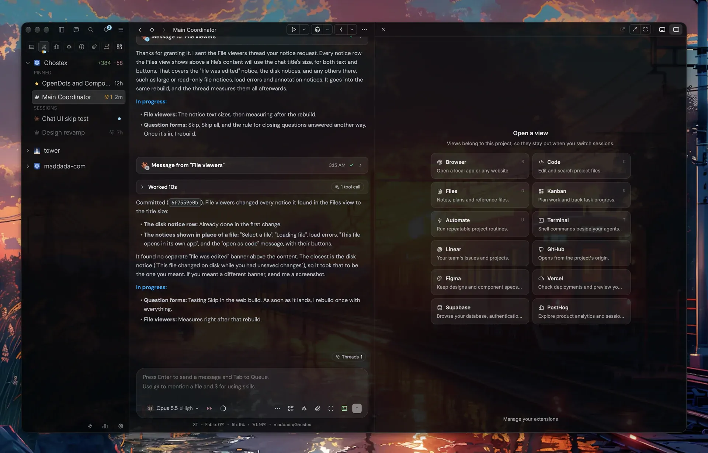](media/readme/gx-hero-1.webp)

**As minimal as you want it.**

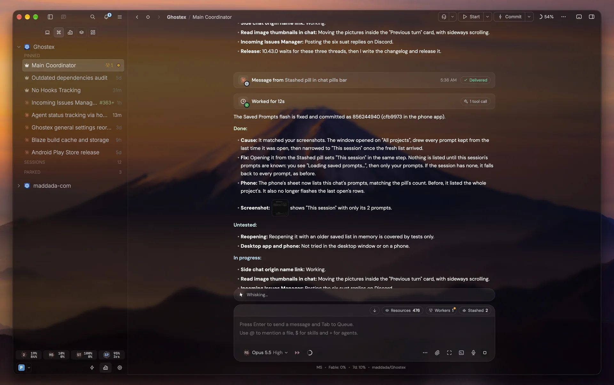

**Coordinators and pages, together.**

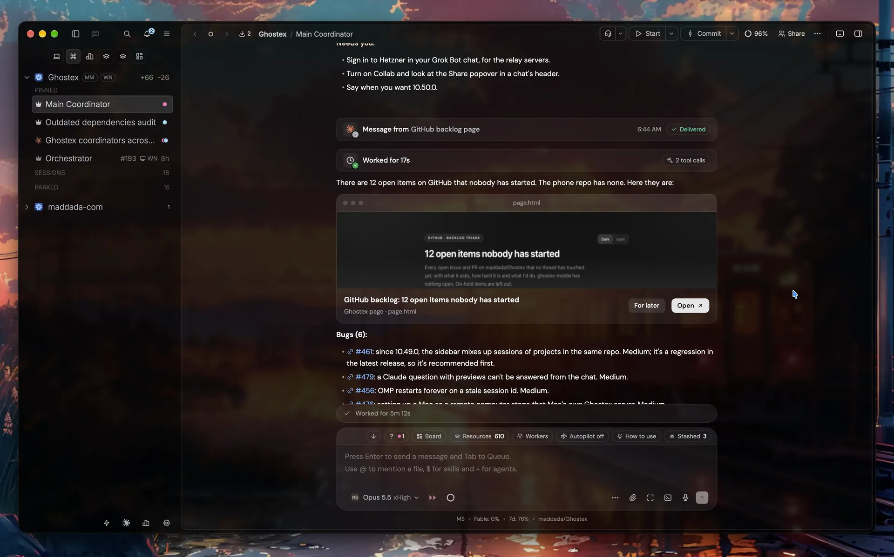

**Pick a design and send your choices in Live HTML Pages.**

Ask the agent to create one for you at any time! This and Coordinators are the 2 best features of Ghostex.

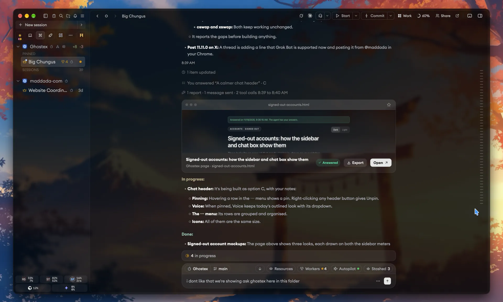


**A full editor, with annotations.**

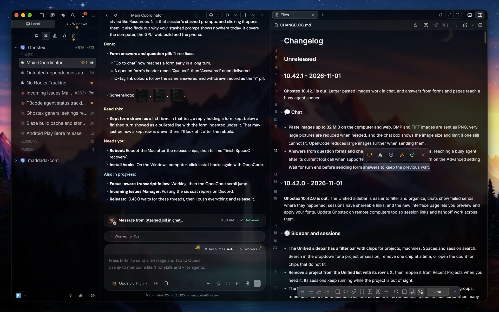

<sub>Want an animated wallpaper behind Ghostex like these? Try [Wallspace](https://wallspace.app/) on macOS (free, recommended), [Lively Wallpaper](https://github.com/rocksdanister/lively) on Windows (free, open source) or [Hidamari](https://github.com/jeffshee/hidamari) on Linux (free, open source; it has no gallery, so add your own videos, for example looping clips from [Pexels Videos](https://www.pexels.com/search/videos/abstract%20loop/), or paste a YouTube link: search for "4K live wallpaper loop"). Move Ghostex to its own desktop or workspace so only the wallpaper sits behind it.</sub>

## Click to Connect GrokBot:

Manage your agents from Grok Bot and send tasks from any thread to any coordinator or session running in Ghostex!

<p align="center"><a href="https://x.ai/bot/W-heW_JNPbQxU7bWKxNP5" target="_blank">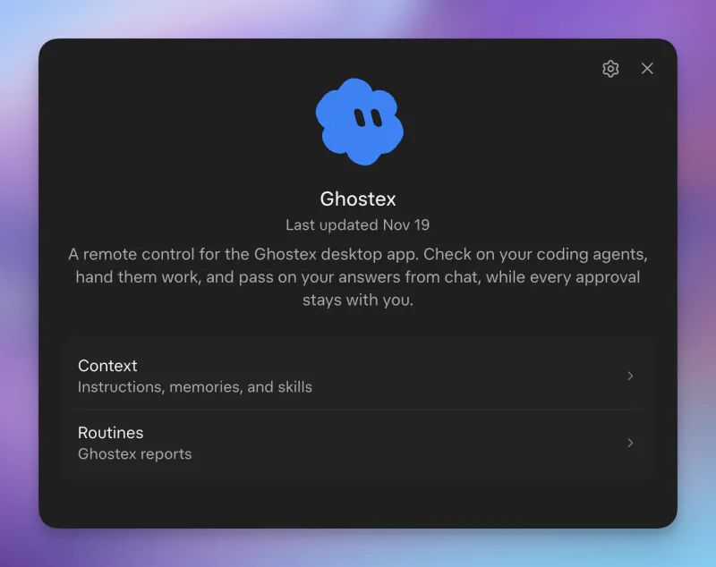</a></p>

## What it does

### 📱 Your agents, in your pocket

Pair the iOS or Android app with one scan. Read transcripts, send follow-ups, preview localhost pages, and get a push when an agent finishes.


### 💬 Chat or CLI, your call

A proper chat with images, readable diffs and sub-agents in view. The raw terminal is one hotkey away.

<details>
<summary>See chat and diffs</summary>


</details>

### 🔀 Any agent, swap mid-task

Claude Code, Codex, OpenCode, Pi, Cursor and more. Pick the model and effort from the chat box, or hand a task to another agent.

<details>
<summary>See the agent picker</summary>


</details>

### 🤖 Agents that run agents

The `ghostex` command lets an agent open sessions, prompt others and read their replies. Or let a coordinator keep track of the threads.


### 📝 Annotate, then send

Mark up plans, HTML and diagrams next to your agent. One click sends every note as numbered feedback.

<details>
<summary>See annotations</summary>


</details>

### 📊 Charts and pages in the chat

Agents answer with charts, tables and stat tiles, or publish a page that opens as a card. Same on desktop, web and phone.

<details>
<summary>See a visual reply</summary>


</details>

### ⏭️ Queue the next prompt

Keep typing while the agent works. Press Tab to queue a prompt; drag to reorder, or play one to interrupt.

<details>
<summary>See queued prompts</summary>


</details>

### 🔎 Find any past session

Fuzzy search every prompt you ever sent, across all your agents. Press Enter to resume. Also available as `gx f` in a terminal.

<details>
<summary>See prompt search</summary>


</details>

**Also in the box:** an on-demand VS Code editor · remote computers over Easy Connect or SSH · Claude and Codex usage with account switching · worktrees, splits and spaces · automations (scheduled prompts) with menu bar and sound notifications · optional plugins such as the Kanban board.

## Works with your agent

[Claude Code](https://docs.anthropic.com/claude/docs/claude-code) · [Codex](https://github.com/openai/codex) · [OpenCode](https://opencode.ai) · [Pi](https://pi.dev) · [oh-my-pi](https://omp.sh) · [Grok](https://x.ai/cli) · [Cursor](https://cursor.com/cli) · [Copilot CLI](https://github.com/features/copilot/cli) · and more.

## Install

### On your computer

**macOS:** [Apple Silicon DMG](https://maddada.com/download/macos-arm64)

<details>
<summary>Or install with Homebrew</summary>

```bash
brew install ghostex
```

</details>

**Windows:** paste this in PowerShell

```powershell
irm https://ghostex.dev/install.ps1 | iex
```

Or download the [x64 installer](https://maddada.com/download/windows-x64) · [ARM64 installer](https://maddada.com/download/windows-arm64). If Windows says it protected your PC, click **More info**, then **Run anyway**; the publisher is "Open Source Developer Mohamad Yahia Youssef".

<details>
<summary>WinGet and Windows details</summary>

```powershell
winget install --id maddada.Ghostex --exact
```

The PowerShell [script](tooling/install/install.ps1) downloads the installer for your PC from GitHub, checks it against GitHub's SHA-256 digest, and runs it, so Windows shows no SmartScreen prompt.

Agents run in native PowerShell by default. Prefer Linux? Switch to WSL in Settings → General → Terminal → Windows Environment. Updates arrive automatically.

</details>

**Linux:** [.deb](https://maddada.com/download/linux-deb-x64) · [.rpm](https://maddada.com/download/linux-rpm-x64) · [AppImage](https://maddada.com/download/linux-appimage-x64) · [AUR](https://aur.archlinux.org/packages/ghostex-bin) · [tar.zst](https://maddada.com/download/linux-tar-x64)

<details>
<summary>Arch Linux, ARM64 and other Linux details</summary>

```bash
# Arch Linux
yay -S ghostex-bin

# Other x64 distributions: extract into /opt/ghostex
sudo tar -xpf ghostex-*-linux-x64.tar.zst -C /

# No package manager: the AppImage copies itself into ~/.local/share/ghostex/appimage on first start
chmod +x ghostex-*-linux-x64.AppImage
./ghostex-*-linux-x64.AppImage
```

ARM64 packages are on the [release page](https://github.com/maddada/Ghostex/releases/latest). To update an AppImage, download the new one and open it. Without FUSE the AppImage says "Cannot mount AppImage": install your distribution's `fuse3` package, or start it with `--appimage-extract-and-run`.

Ghostex offers to install Chromium the first time you open the browser or code editor.

</details>

### On your phone

**iPhone:** [Get it on the App Store](https://apps.apple.com/app/id6771707394)

**Android:** [Download the APK](https://github.com/maddada/Ghostex/releases/latest/download/ghostex-android.apk)

Pair the phone app with Ghostex on your computer using Easy Connect, or use your existing Tailscale tailnet.

## How it compares

<details>
<summary>Open the feature comparison</summary>

| Feature                   | Ghostex | ChatGPT app | cmux |
| ------------------------- | ------- | ----------- | ---- |
| macOS support             | Yes     | Yes         | Yes  |
| Windows support           | Yes     | Yes         | No   |
| Linux support             | Yes     | Yes         | No   |
| Open source               | Yes     | -           | Yes  |
| Ghostty terminal          | Yes     | -           | Yes  |
| Chromium Browser          | Yes     | Yes         | No   |
| Chat GUI view             | Yes     | Yes         | No   |
| Fully featured IDE        | Yes     | -           | -    |
| Built-in Computer use     | Yes     | Yes         | -    |
| Built-in Browser use      | Yes     | Yes         | Yes  |
| Use any model             | Yes     | -           | Yes  |
| Cross Model Orchestration | Yes     | -           | Yes  |
| Rich Prompt Editor        | Yes     | N/A         | -    |
| iOS                       | Yes     | Yes         | Yes  |
| Android                   | Yes     | Yes         | Yes  |
| Automations               | Yes     | Yes         | -    |

</details>

## Privacy & Telemetry

Ghostex sends minimal, anonymous usage telemetry (event counts, OS/version, and closed-enum feature usage) through your local `gxserver` to PostHog using a random per-install UUIDv4 to help us continue supporting and building Ghostex. It never sends prompts, replies, code, file paths, project names, credentials, third-party account IDs, custom CLI/tool names, custom extension names, or custom Boost names (unknown agents, local extensions, and custom Boosts report only `"custom"` or bucketed counts). PostHog derives country-only GeoIP on ingest and discards raw client IP addresses. On brand-new installs, nothing leaves your machine until first-run onboarding completes or is skipped, and daily/weekly events are strictly activity-gated so an idle daemon never phones home.

Turning off the analytics switch in Onboarding Step 2 or **Settings > About** (`"analyticsEnabled": false`) stops all usage and feature tracking immediately and sends only 1 anonymous weekly active install count (random install ID + `analytics_enabled: false`, zero other properties, only when used that week). Setting `DO_NOT_TRACK=1`, `GHOSTEX_TELEMETRY_DISABLED=1`, or `--no-analytics` stops even that completely (0 events ever). See [ANALYTICS.md](ANALYTICS.md) for the complete list of every event and property, plus **Settings > About > View what's sent** or `GHOSTEX_TELEMETRY_DEBUG=1` to inspect live payloads.

## Community

[Discord](https://discord.gg/df7b3G92CS) for help and feature talk · [Issues](https://github.com/maddada/Ghostex/issues) for bugs and ideas · [Contributing](CONTRIBUTING.md) to help with ports, agents, docs and polish.

## Ghostex builds on open source work from these projects and communities:

- [Ghostty](https://github.com/ghostty-org/ghostty) and [Zed / GPUI](https://github.com/zed-industries/zed) for the terminal and native shell
- [CEF](https://github.com/chromiumembedded/cef) for embedded Chromium panes
- [Trycua](https://github.com/trycua/cua) for built-in Computer Use
- [VS Code](https://github.com/microsoft/vscode) and [code-server](https://github.com/coder/code-server) for the embedded IDE
- [Beads](https://github.com/gastownhall/beads) by [Steve Yegge](https://github.com/steveyegge) and [Beads Viewer](https://github.com/Dicklesworthstone/beads_viewer) for the Kanban board
- [OpenUsage](https://github.com/robinebers/openusage) for usage stats
- [Agentation](https://github.com/benjitaylor/agentation) for browser annotation tooling, including [Ghostex's fork](https://github.com/maddada/agentation/tree/ghostex)
- [cmux](https://github.com/manaflow-ai/cmux) for agent hook and notification patterns
- [zehn](https://github.com/al3rez/zehn) by [al3rez](https://github.com/al3rez) for prompt-history search
- [vvterm](https://github.com/vivy-company/vvterm) and [Termux](https://github.com/termux/termux-app) for mobile terminal components
- [Pierre](https://github.com/pierrecomputer/pierre) for diff and file rendering components

## More screenshots:

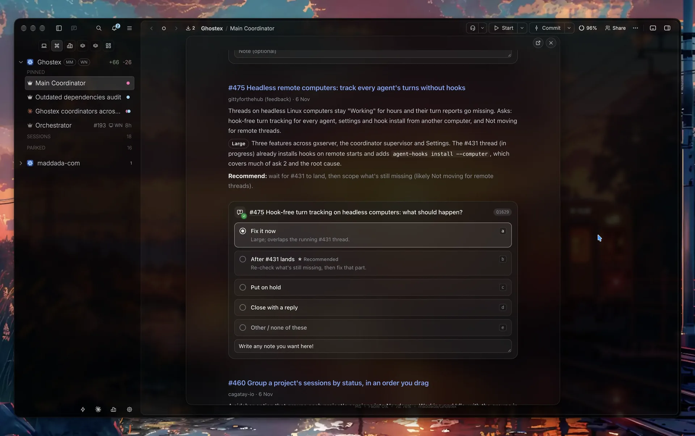

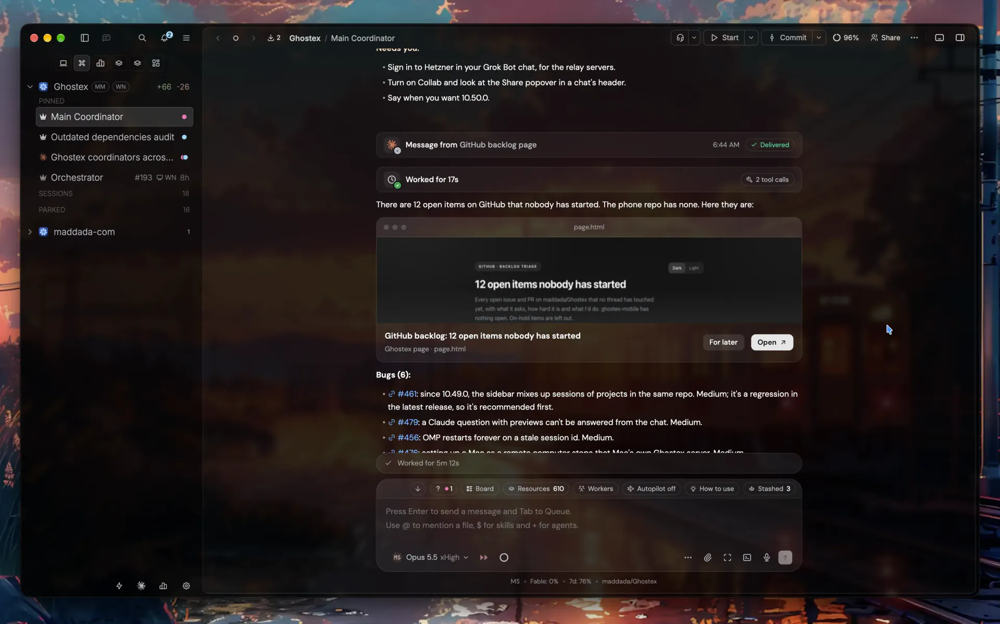

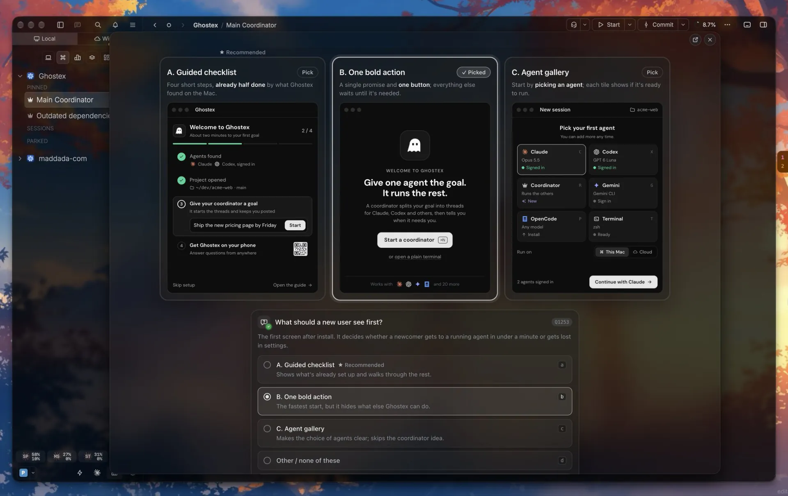

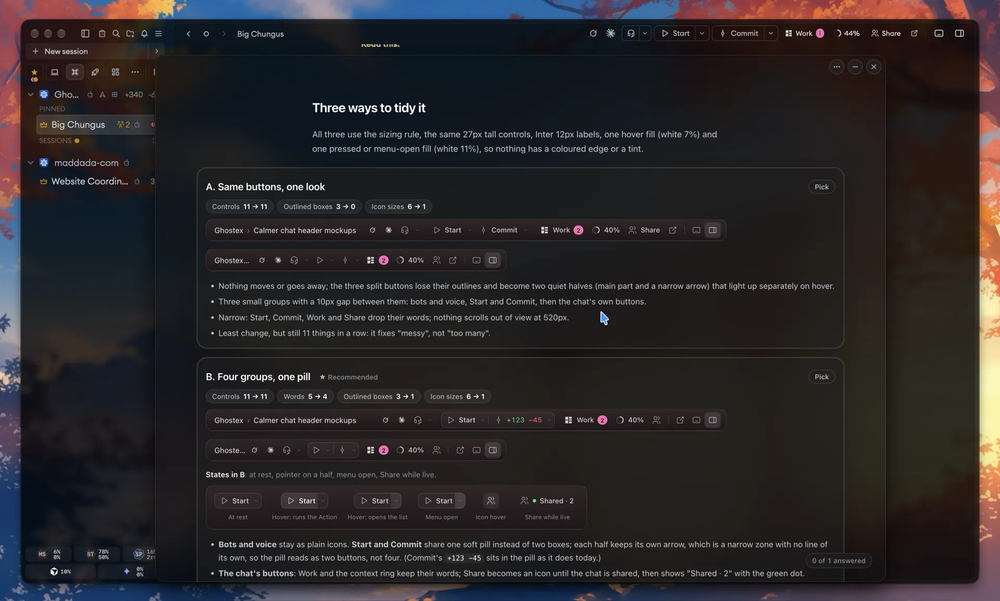

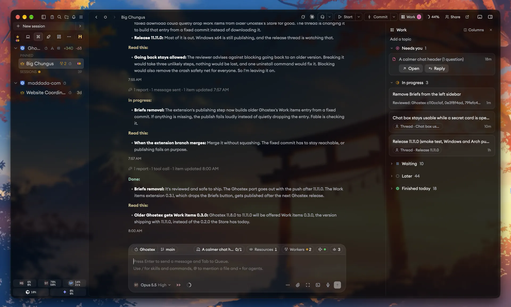

Free and open source under the [MIT License](LICENSE).
